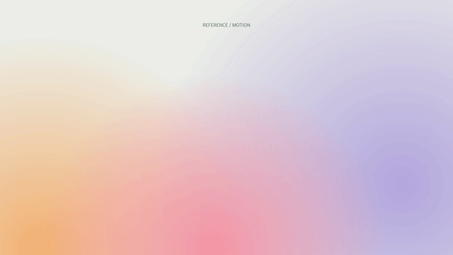

# Reference Motion

**Turn a motion reference into a film about your product.**

An open-source Agent Skill with a small Canvas/FFmpeg rendering toolkit. It teaches
an agent to study the actual edit, ground the subject in current product material,
translate the reference's motion language, and deliver a verified, accessible film.



[Download the demo and skill package](https://github.com/lemohammed/reference-motion/releases/latest)
· [Read the skill](skills/reference-motion/SKILL.md)

## Use the skill

Install the release ZIP through a compatible plugin host, or place
`skills/reference-motion/` in your agent's supported skill directory. You can also
point an agent directly to its `SKILL.md`.

Example request:

> Use $reference-motion to adapt this video's motion style to my product. Read the
> current product brief, preserve the requested audio treatment, and deliver an
> editable film plus a watch/download link.

The package uses the portable `plugin.json` + `skills/` layout described in the
[official packaging guide](https://developers.openai.com/plugins/build/plugins).
It needs no MCP server, hooks, API key, or hosted service to render the demo.
Image generation and cloud delivery use tools available in the agent's environment.

## Run the original demo

Requires Node.js 20+, FFmpeg and FFprobe, plus an available system font.

```sh
git clone https://github.com/lemohammed/reference-motion.git
cd reference-motion
npm install
npm run check
npm test
npm run demo
```

The film, original procedural score, poster and verification receipt appear in
`runs/demo/`. All demo visuals and sounds are generated from the included source;
there are no third-party photographs, fonts or recordings in the package.

## Render your own scene

Write a manifest and a scene module using the
[rendering contract](skills/reference-motion/references/rendering.md), then run:

```sh
node skills/reference-motion/scripts/render.mjs path/to/film.json runs/film/output.mp4
```

The renderer streams frames with backpressure, snapshots generated textures into
immutable images, verifies the expected frame count and audio, and promotes a
pending export only after success. A failed render preserves the last good file.

Useful helpers:

- `inspect-reference.mjs VIDEO DIRECTORY` — reference contact sheet and metadata.
- `verify-media.mjs VIDEO MANIFEST` — decode, duration, frame count, audio and hash.
- `perspective.mjs` — perspective image planes with clipped overlapping texture
  triangles to avoid visible seams.

The starter shows typography, gradients and moving cards. It is a demonstration,
not a requirement to use that look for every product. Photographic references need
appropriate photographic material; naming an effect is not visual fidelity.

## Scope and evidence

The skill separates the reference's style from its subject. It preserves approved
creative decisions, keeps copy tied to current product evidence, and treats
rendering, upload, playback and user acceptance as different checks.

The toolkit is not a universal video editor, photoreal 3D engine, music catalog or
automatic hosting service. Creative review remains necessary. Reusing a reference's
audio is a separate media-rights decision; the code license does not license that
recording. See [delivery](skills/reference-motion/references/delivery.md).

## Development and license

Checks run locally. This repository contains no hosted CI workflows.
The integration tests cover complete rendering, short-audio rejection and
preservation of a previous output after a deliberate scene failure.

MIT licensed. See [LICENSE](LICENSE). Dependencies retain their own licenses.
